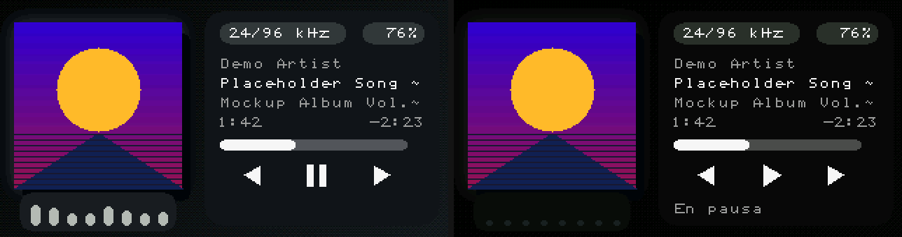
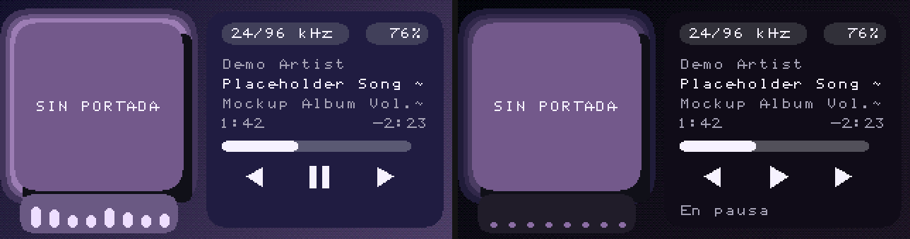

# Aura

`themes/aura/` is the data-only lock screen. With a cover, the diagonal wash
comes from `art_bg_a` / `art_bg_b`, the halo from `art_glow` and the card
from `art_panel`. With `art_ok` false, every one of those falls back to the
dusk palette in `theme.cfg` (deep indigo, lilac accent). Strings are English
and ASCII (`Paused`, `NO COVER`, `LIBRARY`, `NOW PLAYING`, `SETTINGS`).

Install by copying the directory to `/.rechord/themes/aura/`.

## Now Playing

Full-screen dithered diagonal gradient, three rounded halo rings, a offset
shadow, then the 120 px `art` (square: the engine does not clip a cover to a
round rect). The right side is a solid card so the opaque 8×8 text does not
stamp the gradient. On it: a `bits/rate` pill (`24/96 kHz`), the battery
percent (red below 15%), artist, title, album, elapsed and remaining time,
a pill progress bar, and prev / pause / play / next as 1-bit glyphs.

Under the cover, eight capsules follow `(lvl_l + lvl_r) / 2`, each with its
own `sin()` phase, tinted toward `art_glow`. They sit in a small tray that is
redrawn with them.

Pause (`playing == 0`) darkens the wash, the halo and the card, swaps the
pause glyph for play, rests the capsules and shows `Paused`. A state change
already full-redraws Now Playing, so those colours update without marking the
gradient dynamic. The animated band is only the tray and the progress pill
(`refresh_ms=80`), which keeps the cover from being re-read every tick.

## Home and lists

Home is the `AURA` wordmark, the current title, and the same three-item
list as Glifo. Library, category, browser and Settings use a surface header
and an accent rule; the compiled screen still owns the rows.

## Budget

| item | value |
|---|---|
| now_playing.skin | 3817 / 4096 B, 37 / 52 sections |
| assets | 5 files, 448 / 1024 B (`prev`, `next`, `play`, `pause`, `logo`) |

Glyphs are original drawings, raw MSB-first. There is no theme-bitmap
generator in the repo, so the rasteriser was not committed.

## Differences from the mockup

* The large proportional title does not exist in the engine. Artist, title
  and album are 8×8 on a card.
* The cover stays square. The halo is the rounded rects behind it.
* The format pill uses `/` (`24/96 kHz`). The font has no middle dot.
* Capsules are a tray of eight bars, not a free row of pixels on the wash.
  Their colour is `art_glow` mixed toward the label so a dark glow still reads.

Screenshots (engine, `tools/theme_preview/run.sh`):

