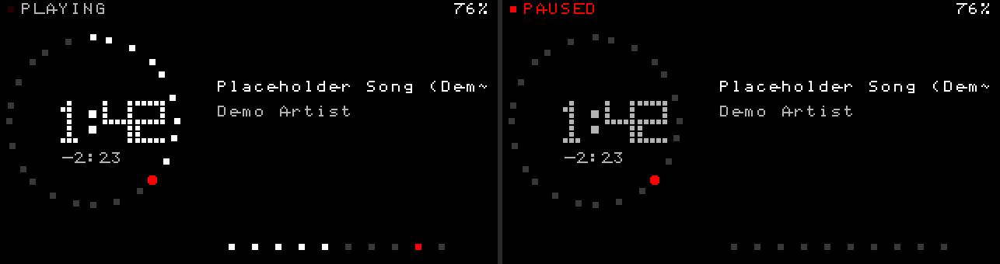
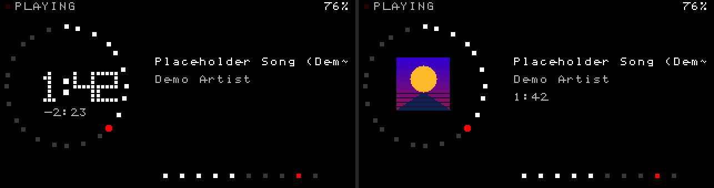
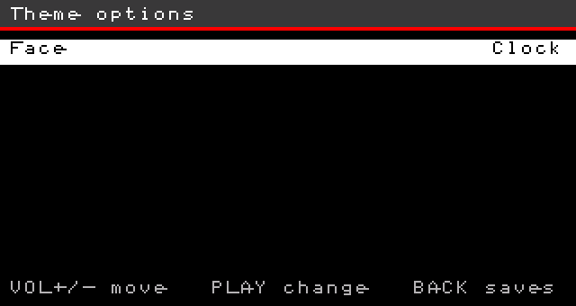

# Glifo

`themes/glifo/` is the data-only Nothing-style screen: pure black, one red,
a ring of 24 lamps and a dot-matrix clock. Strings are English and ASCII
(`PLAYING`, `PAUSED`, `STOPPED`, `NO COVER`) — the built-in font has no
accents.

Install by copying the directory to `/.rechord/themes/glifo/` and choosing
**Glifo** in Settings. Nothing in the package is compiled.

## Options

```
opt_face=Face,Clock|Artwork
```

Hold PLAY on **Settings → Interface → Theme** to open **Theme options**, then
press to switch. The choice is saved per theme (`theme_opts=glifo:<digit>;`
in `rechord.cfg`), so switching to another theme and back keeps it.

| face | Now Playing hero |
|---|---|
| Clock (0, default) | the 5×7 dot-matrix elapsed time inside the ring |
| Artwork (1) | the album cover (`art size=small`) inside the ring |

The ring, the red playhead, the header, the ten level lamps and the metadata
are shared by both faces. Artwork drops the digits and their two cover strips
(`visible=!opt_face`) and shows the cover plus `pos_fmt` where the remaining
time used to be.

## Now Playing

Left: 24 lamps on a circle (`sin()` at 15° steps, same function as the red
playhead, so the head sits on its lamp). Lamps already passed are white while
playing and drop back to the dim grey when paused. The head is a larger red
disc; while paused it blinks (`mod(t, 800) < 400`).

Clock face: the elapsed time is a 5×7 dot matrix, each cell scaled to a 3 px
block (19×27). Ten digits do not fit in eight assets, so they are stacked in
pairs (`d01` is 0 over 1, through `d89`). The skin shifts the bitmap by one
glyph and paints a black strip over the other half. The colon is its own 8×27
bitmap. Remaining time, the header and the metadata use the 8×8 font.
`lvl_l`/`lvl_r` drive a row of ten lamps; the peak lamp is red. Battery under
15% turns the percent red.

Artwork face: the same ring and lamps around the small (`48 px`) cover the
firmware streams from `ARTPACK.BIN`; a track without a cover draws the `art`
placeholder block in `surface`, so the ring never surrounds an empty hole.

`refresh_ms=100` redraws the whole skin. The cover is re-streamed at that rate
on the Artwork face — raise `refresh_ms` if that matters more than the level
lamps.

## Home and lists

The home shows the `GLIFO` wordmark (1-bit, pitch-2 dot matrix), the current
title while a track is loaded, and a vertical list. Library, category,
browser and Settings keep the compiled behaviour and draw a grey header with
a red rule.

## Budget

| item | value |
|---|---|
| now_playing.skin | 4046 / 4096 B, 52 / 52 sections |
| assets | 7 files, 949 / 1024 B (`d01`…`d89`, `colon`, `logo`) |

Adding the Artwork face to a skin that was already 52/52 and 14 bytes under
the cap needed a refactor rather than a new section: the full-screen `[bg]`
fill went away (the app clears the framebuffer to `background` before every
skin draw, and `z` is that same colour), the redundant `bg=z` properties went
away (background is the engine default), the four digit bitmaps and two cover
strips took `visible=c`, and the remaining time became the `rl` variable so
one `[rem]` section serves both faces. The album line was dropped: 52
sections is a hard cap and the cover carries the album on the Artwork face.

The digit bitmaps are original 5×7 drawings, raw MSB-first rows. The repo has
no theme-bitmap generator, so the rasteriser was not committed.

## Differences from the mockup

* No theme font. The huge title/artist of the mockup is the 8×8 font,
  truncated with `~`. The clock is the bitmap hero.
* Ring lamps are 4×4 squares. The playhead is the round red disc.
* `24/96` and the `03 / 14` playlist counter are not on this screen. The
  skin is full: 52 sections.
* The header reads `PLAYING` rather than the mockup's `NOW PLAYING`.

Screenshots (engine, `tools/theme_preview/run.sh`):






